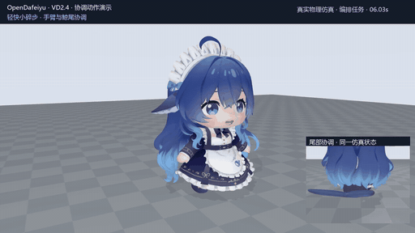
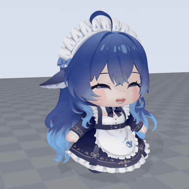
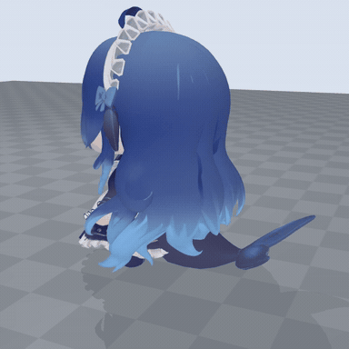
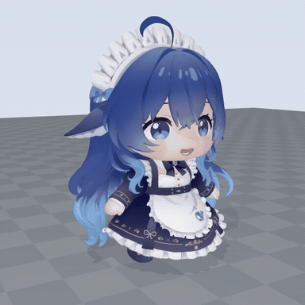

# DeepSeek Whale-chan Robot · DeepSeek 鲸鱼娘具身机器人 🐋

**让 DeepSeek 大肥鱼走进现实。**

面向 AI 陪伴与人机互动的开源具身项目。以社区角色 DeepSeek 鲸鱼娘（大肥鱼 / Whale-chan）为形象，已在 MuJoCo 中实现双足小碎步、转向、鲸尾协调与表情交互。我们正在把她做成能对话、能接受任务、可持续扩展行为的具身伙伴，逐步走向实体机器人。

持续更新中 · 当前为 MuJoCo 仿真阶段。

当前源码提供 [DeepSeek 文本交互](docs/INTERACTION.md)、[接触步态与停稳](docs/CONTACT_WALK.md)，以及[点头、组合动作、暂停与继续](docs/BEHAVIORS.md)。默认入口与下方39秒演示仍为 VD24；新增入口通过源码运行。

**简体中文** · [English](README.en.md) · [日本語](README.ja.md)

[完整演示](https://cyanseek.github.io/deepseek-whalechan-robot/watch.html) · [快速开始](#快速开始) · [路线图](#路线图) · [交给 Agent](#交给-agent) · [开发文档](docs/CHARACTER.md)

[](https://cyanseek.github.io/deepseek-whalechan-robot/watch.html)

**MuJoCo 物理仿真 · 三轴鲸尾 · 动作与表情协调 · VD2.4**

上方动图是完整录像第 6–12 秒的原速节选，循环播放；点击查看 **[39 秒 / 60fps 连续演示](https://cyanseek.github.io/deepseek-whalechan-robot/watch.html)**（[下载原片](https://github.com/cyanseek/deepseek-whalechan-robot/releases/download/vd24-ar2/DeepSeek-Whalechan-Robot-VD24-demo.mp4)）。完整片段包含问好、行走、停稳小跳、转向、挥手摆尾和休息。物理身体由执行器和地面接触驱动，高层动作按演示顺序编排。

## 当前能力

| 挥手打招呼 | 微笑与表情切换 |
| :---: | :---: |
|  |  |
| **三轴鲸尾摆动** | **小碎步与动作协调** |
|  |  |

动图均为真实仿真原速节选；挥手来自完整演示，表情和尾巴为独立场景录制。[场景、时间段与复现命令](docs/DEMO.md)

- **运动与表达**：小碎步、转向、挥手与实验性小跳，三轴鲸尾和手臂随动作协调。
- **视觉与表情**：睁眼微笑、自然眨眼、平滑表情过渡，以及服装与显示适配。
- **感知与交互**：机器人 RGB 相机识别颜色标记并接近；任务取消根据支撑状态结束步伐。
- **仿真与复现**：23 个执行器、自由基座、地面接触与力矩限制；保存录像、轨迹、结果与源码快照。

当前使用显式 IK/PD 控制和理想仿真本体反馈，验证范围为平地场景。小跳幅度仍低，快走稳定性与落地控制仍在改进。[演示与实测范围](docs/DEMO.md)

## 快速开始

**先看效果，无需安装：** [39 秒完整视频](https://cyanseek.github.io/deepseek-whalechan-robot/watch.html)。

**本地运行：** 下面的步骤适用于项目源码目录。已验证环境是 Windows、Python **3.13.5**、MuJoCo **3.3.7**；物理和控制在 CPU，画面通过 OpenGL 渲染。演示不需要 API Key 或语言模型。当前提供源码运行方式。

### 1. 准备环境

打开 PowerShell，获取源码并创建环境：

```powershell
git clone https://github.com/cyanseek/deepseek-whalechan-robot.git
cd deepseek-whalechan-robot
py -3.13 -m venv .venv-sim
./.venv-sim/Scripts/python.exe -m pip install -r requirements-character.txt
```

### 2. 准备角色资产

当前 VD24 使用配套 **AR2 运行资产包**（约 29.5 MB），包含匹配模型、蒙皮、纹理与表情绑定，无需自行改模型：

```powershell
./.venv-sim/Scripts/python.exe tools/install_character_assets.py
./.venv-sim/Scripts/python.exe tools/character_preflight.py --delivery assets/local/BlueFatFish_Visual_Delivery
```

安装器从 [GitHub Release](https://github.com/cyanseek/deepseek-whalechan-robot/releases/tag/vd24-ar2) 下载、校验并解压到 `assets/local/BlueFatFish_Visual_Delivery/`，保留已有文件。也可[手动下载模型包](https://github.com/cyanseek/deepseek-whalechan-robot/releases/download/vd24-ar2/DeepSeek-Whalechan-Robot-Assets-AR2-VD24.zip)后使用 `--archive` 离线安装。[安装说明](docs/ASSETS.md)

输出 `ready_for_native_check` 表示依赖元数据与资产文件检查通过；接着运行真实仿真。

### 3. 让她动起来

```powershell
# 打开可交互窗口
./Start-BlueFatFish.ps1 -Delivery assets/local/BlueFatFish_Visual_Delivery

# 运行完整演示，同时保存 60fps 原速录像
./Start-BlueFatFish.ps1 -Delivery assets/local/BlueFatFish_Visual_Delivery -Scenario coordinated -Seconds 39 -Record -Presentation -Fps 60
```

| 按键 | 行为 | 按键 | 行为 |
| --- | --- | --- | --- |
| W / A | 前进 / 转向 | J | 实验性小跳 |
| T / G | 摆尾 / 挥手 | E | 切换表情 |
| R | 走近红色标记 | C / 空格 | 取消当前任务 |
| V / D | 切换机位 / 碰撞视图 | 关闭窗口 | 结束运行 |

每次启动自动建立独立的 `runs/` 目录。录制文件为 `simulation.mp4`，结果为 `run.json`，其余轨迹和快照见[输出说明](docs/AGENT_GUIDE.md#outputs)。取消任务采用接触感知的动作结束流程。

### 体验可打断互动

打开离线面板，输入“过来”“停一下”“继续”“打个招呼”。接近任务使用机器人相机识别红色标记；动作按完成反馈衔接。

```powershell
./.venv-sim/Scripts/python.exe -m pip install -r requirements-contact.txt
./Start-WhaleChan-Behaviors.ps1 -Backend commands -Record

./.venv-sim/Scripts/python.exe tools/run_behavior_demo.py --out runs/behavior-demo-01 --video
```

完整自动文本客户端演示包含行走、暂停、继续和挥手→摆尾→点头；录制约46秒仿真过程。接入自己的 DeepSeek API 见[配置说明](docs/INTERACTION.md)，组合动作接口见[开发文档](docs/BEHAVIORS.md)。

## 路线图

我们的目标是让大肥鱼成为能对话、能行动、有角色个性的具身伙伴。一个具体的体验是：你说“过来”，她走近打招呼；途中说“等一下”，她停稳并回应；换个目标，她继续完成新的任务。

| 阶段 | 内容 |
| --- | --- |
| **已有：身体与表达** | MuJoCo 双足小碎步、鲸尾协调、表情、颜色目标接近与可取消任务；配套资产安装器和真实录像。 |
| **源码可用：文本与动作** | DeepSeek 文本意图、可打断接近与停稳、头部反馈、动作组合和暂停/继续；支持离线明确指令。 |
| **下一步：运动与语音** | 速度跟踪、足滑与抗扰平衡，匹配身体的学习策略，以及语音输入。 |
| **继续扩展：教她新行为** | 把问好、跟随、陪伴等行为做成可复现示例，提供稳定的任务接口，让开发者和 Agent 添加、测试与分享新行为。 |
| **走向实体：仿真到实机** | 完成机械、电机、传感器与标定，让同一套任务逻辑驱动实体身体，逐步验证迎接互动、桌边陪伴和日常提醒。 |

DeepSeek 接口处理文本与高层意图，本地控制负责平衡、动作与结果反馈。当前源码包含可复现的行为组合；默认 VD24 使用 IK/PD，可选接触步态使用约束逆动力学。学习步态、语音与实机是后续方向。[开发路线与验收目标](docs/ROADMAP.md)

## 交给 Agent

把这段话交给能访问项目文件的编程 Agent：

> 阅读 README.md、docs/AGENT_GUIDE.md 和 project-info.json。检查角色资产与依赖，先运行 2 秒站立检查，再运行 VD24 的 39 秒 coordinated 场景。使用新的输出目录，报告 run.json 中的结果并给出录像路径；缺少资产时说明缺少哪些文件。

提供 [Agent 操作指南](docs/AGENT_GUIDE.md)、[机器可读项目信息](project-info.json) 和 [llms.txt 文档索引](llms.txt)。入口是现有 Python CLI，可供 Agent 调用和解析；演示本身不需要 LLM。

## 开发与贡献

从[当前身体与控制](docs/CHARACTER.md)了解实现，从[实测记录](docs/DEMO.md)查看验证范围。

欢迎参与步态与落地控制、DeepSeek 对话和语音、互动设计、许可明确的模型适配，以及实体机器人的机械与控制。每个贡献从一个具体场景开始，附上输入、预期行为和重跑命令。[贡献指南](CONTRIBUTING.md)

项目路线：**S1 设计与仿真 → S2 实体机器人**。

别名：**DeepSeek 大肥鱼 / DeepSeek 鲸鱼娘 / Whale-chan / whale girl / DeepSeek-chan / OpenDafeiyu**。

## 来源与许可

感谢相关创作者与开源社区。

- **二次元形象与生成图参考**：[Neko3000 / DeepSeek Whale-chan](https://github.com/Neko3000/deepseek-whalechan) 与 [YunYueSama / codex-deepseek-pet](https://github.com/YunYueSama/codex-deepseek-pet)。其中 Neko 的[角色来源说明](https://github.com/Neko3000/deepseek-whalechan/blob/main/THIRD-PARTY-NOTICES.md)列出了 B 站创作者 [ZipZipPipe](https://space.bilibili.com/4168597) 和 [上善无形](https://space.bilibili.com/4456176)。在上述参考基础上，我们也使用 GPT 辅助开展形象方案补充与细节完善。
- **基础模型与原画**：木子恶魔的[大肥鱼作品](https://www.aplaybox.com/details/model/ayXkRzVflmnd)；原文件取得渠道为 [dsh-plugin-vrmpet3d](https://github.com/drliuhuan/dsh-plugin-vrmpet3d/tree/13cb2a2532ce34fa7dfd6ff2715da4f50565b161)。
- **本项目的具身实现**：在收到的姿态与显示适配基础上，新增动态身体、接触与力矩约束、运动控制、任务交互、步态与鲸尾协调，以及服装、表情和视觉运行时优化。原模型及原表情形态键的创作归属保留。
- **机器人技术参考**：[MicroDuck](https://github.com/pollen-robotics/microduck) / [MicroDuck RL](https://github.com/pollen-robotics/microduck_rl) 作为具身产品、训练与部署路线的主要参考；[Open Duck Mini](https://github.com/apirrone/Open_Duck_Mini) / [Open Duck Playground](https://github.com/apirrone/Open_Duck_Playground)。

自有代码采用 [MIT](LICENSE)。第三方模型、美术及含其形象的演示素材按各自许可处理，不能由代码许可证推定可再分发；具体资产条件见[资产说明](docs/ASSETS.md)与 [NOTICE](NOTICE.md)。这是独立社区项目，与 DeepSeek 无官方隶属关系。
