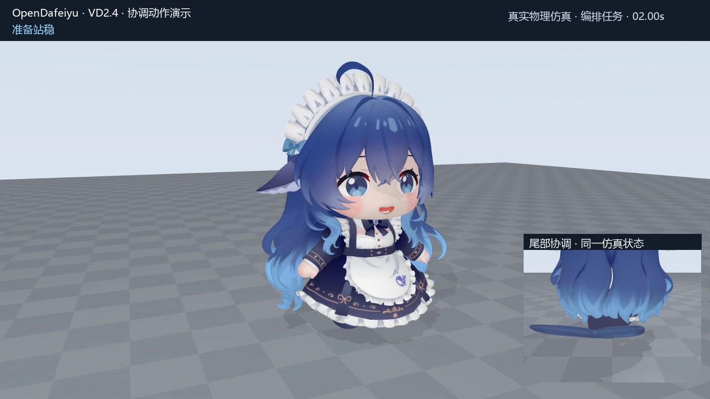

# VD2.4 demonstration / 演示与实测

[中文首页](../README.md) · [English](../README.en.md) · [日本語](../README.ja.md)

## Watch

[](https://cyanseek.github.io/deepseek-whalechan-robot/watch.html)

[Play the complete video: 39 s, 60fps, 1× playback](https://cyanseek.github.io/deepseek-whalechan-robot/watch.html) · [Download the original](https://github.com/cyanseek/deepseek-whalechan-robot/releases/download/vd24-ar2/DeepSeek-Whalechan-Robot-VD24-demo.mp4)

This is native MuJoCo simulation recorded with a director view and detail camera. The high-level sequence is prescribed; the body is integrated dynamically. The original recording has 39.000 s simulated time and 39.170 s wall time. A fresh public-source reproduction completed 39 s of simulation in 33.443 s wall time; both videos play at 1× simulated speed.

| Approximate time | Action to watch |
| --- | --- |
| 0–5.7 s | Settling and greeting |
| 5.7–16.3 s | Small-step walking, coordinated arms/tail and stopping |
| 16.3–22.6 s | Preparation, a low hop and landing; foot detail inset |
| 22.6–27.1 s | Turning and stabilization |
| 27.1–33.1 s | Wave, tail gesture and facial response |
| 33.1–39 s | Rest and completion |

Transitions are governed by the demonstration state and controller completion. These ranges help navigation; they are not universal timing guarantees.

## Measured scope

Snapshot: 2026-10-21, VD24, run `20261021-VD24-final03`. No hardware is shown.

| Measurement | Result |
| --- | --- |
| Full sequence | 39 s / 2340 frames / 60fps; final phase `ready`, failure `null` |
| Actuators | 23 |
| Same 9 s walking window | VD23 99.93 mm → VD24 172.22 mm forward displacement |
| Actual cadence in the full sequence | approximately 1.66 steps/s |
| Full-sequence hop | 6.675 mm peak foot clearance, 57 ms main flight interval |
| Standalone hop scenario | 9.767 mm peak foot clearance, 79 ms main flight interval |
| RGB approach regression | `arrived`, then stable `ready`; separate precision gait |
| Public runtime validation | 45 passed / 0 skipped in a fresh Windows environment; native MuJoCo tests executed |

The hop values measure foot clearance, not center-of-mass rise. Hops are still low, and stable large jumps and running remain development work. The faster manual/demo gait does not imply a faster RGB approach. Flat-ground recorded cases do not establish rough-terrain or hardware performance.

## Media files

| File | Relationship to the recorded run |
| --- | --- |
| [demo.mp4](media/vd24/demo.mp4) | Byte-identical copy of the complete original recording. |
| [demo-web.mp4](media/vd24/demo-web.mp4) | Smaller H.264 web version; same 39 s duration and 1× speed. |
| [walk.gif](media/vd24/walk.gif) | Seconds 6–12, reduced spatial/frame resolution, looping at 1× speed. |
| [wave.gif](media/vd24/wave.gif) | Original demo, seconds 2.5–6; body crop, 384 px / 10fps, 1× speed. |
| [expressions.gif](media/vd24/expressions.gif) | Independent expression scenario, seconds 1.5–7.5; face crop, 384 px / 10fps, 1× speed. |
| [tail.gif](media/vd24/tail.gif) | Independent tail scenario, seconds 3–8; rear-side body crop, 384 px / 10fps, 1× speed. |
| [walk-detail.gif](media/vd24/walk-detail.gif) | Original demo, seconds 6–12; body crop, 384 px / 10fps, 1× speed. |
| [expressions.mp4](media/vd24/expressions.mp4) / [tail.mp4](media/vd24/tail.mp4) | Full independent native recordings: 13 s and 10 s, each 30fps. |
| [hello.png](media/vd24/hello.png) | Frame at 2 s, copied from the existing presentation set. |
| [tail.png](media/vd24/tail.png) | Frame at 26 s from the same run. |
| [smile.png](media/vd24/smile.png) | Frame at 35 s from the same run. |

The [media manifest](media/vd24/manifest.json) records hashes and transformations. No generated footage substitutes for physics evidence.

The [public-source validation report](media/vd24/validation.json) includes the stand, expressions, tail and coordinated runs, timings and source fingerprints. The expression run validates returning from closed eyes to the default smile without a missing-weight exception.

OpenDafeiyu, visible in the recording overlay, is an alias of DeepSeek Whale-chan Robot.

## Reproduce

Follow the [source setup](../README.en.md#quick-start) and [agent CLI guide](AGENT_GUIDE.md). Runs create their own model and source snapshots. Model archives include character data and retain its separate terms; do not treat the entire output directory as an MIT distribution.

The README version is the current visual/control profile, not a PyPI release number. Earlier VD23, VD22, VD21, VD2 and VD1 paths remain selectable in the launcher. Historical frozen deliveries stay unchanged.

Record the focused scenarios from the project root (each output directory must be new):

```powershell
./.venv-sim/Scripts/python.exe tools/run_bluefatfish_v2.py --profile VD24 --scenario expressions --seconds 13 --video --fps 30 --presentation --out runs/expressions-01
./.venv-sim/Scripts/python.exe tools/run_bluefatfish_v2.py --profile VD24 --scenario tail --seconds 10 --video --fps 30 --out runs/tail-01
```
